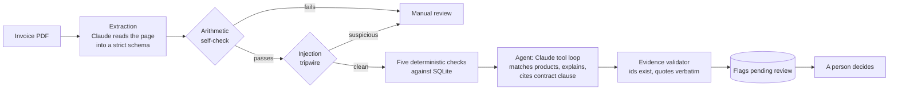

# Invoice Reconciliation Agent

An AI agent that checks a restaurant's supplier invoices against the agreed price lists,
contracts, delivery notes and a dated VAT table. It proposes a flag for each anomaly, with the
evidence that supports it. **A person always decides.**

> **Claude reads and explains, deterministic checks decide, a human approves.** The evaluation
> was built first, with a rule-only baseline, so every AI component had to beat a measured
> baseline before it was used.

[](https://github.com/DataOyster/invoice-agent/actions/workflows/ci.yml)
· Python 3.12 · Anthropic API · MCP · SQLite · BM25 · all data synthetic

## What it catches

| Anomaly | Rule | Source of truth |
|---|---|---|
| Price above agreement | Unit price above the agreed price valid on the **delivery date** (1% tolerance) | Price list |
| Duplicate invoice | Same supplier and number, or same supplier, date and total | Invoice archive |
| Wrong VAT | Rate differs from the dated table for that category and **delivery date** | VAT table (food 12% → 6% on 1 April 2026) |
| Quantity mismatch | Invoiced quantity differs from what was delivered (1% tolerance) | Delivery note |
| Confused unit | Price only matches when read in another unit (kg versus case) | Price list, weight per pack |

Each flag cites its evidence: a price-list entry, a delivery note, a VAT rule or an earlier
invoice. Where the contract applies, the flag also carries a clause quoted **word for word**.
False alarms are preferred over misses, because a miss means paying money. The reasoning is
in [docs/SPEC.md](docs/SPEC.md).

## How it works



- **Extraction:** Claude receives the PDF, text and page image, and returns schema-validated JSON
  (`messages.parse` with Pydantic). Confidence comes from the invoice's own arithmetic, not
  from the model's opinion. Below 0.9 the invoice goes to a person. A rule-based extractor
  (pdfplumber + regex) is the baseline and the fallback.
- **Checks:** plain Python against the shared `Repository` (SQLite). They alone decide which flags
  exist.
- **Agent:** a manual tool-use loop with four tools:
  - `list_supplier_products`;
  - `run_checks`;
  - `search_contract`;
  - `submit_review`.

  It matches oddly printed products to the catalogue, writes a short explanation and picks the
  contract clause. It **cannot add or remove flags**. Every product match and every quote is
  validated. Step, cost and time limits come from `.env`. There is no model call when nothing
  needs one.
- **RAG:** BM25 over contract clauses (one clause per chunk). A supplier filter is required.
  Queries use the catalogue's English names, because the contracts are English while the
  invoices are Swedish, English or Italian.
- **MCP:** a read-only server lets Claude Desktop ask questions like "which suppliers raised
  prices in July?". See [docs/MCP.md](docs/MCP.md).

## Results

Measured on synthetic data with `claude-haiku-5-5`. Numbers from the reproducible report
[docs/eval/report.md](docs/eval/report.md).

The **hard split** has 30 invoices with an unseen layout, image-only scans, 3–4° rotation and
product names printed differently from the catalogue. It contains 10 injected anomalies and 4
traps.

| | Rules only (no AI) | Agent on rule reads | Claude extraction + agent |
|---|---|---|---|
| Key fields read correctly | 36.7% | n/a | **100%** |
| Lines matched to the catalogue | 0 / 125 | 33 | **125 / 125** |
| Sent to manual review | 21 / 30 | 21 / 30 | **0 / 30** |
| Anomalies found | 0 / 10 | 4 / 10 | **10 / 10** |
| False flags / traps flagged | 0 / 0 | 0 / 0 | **0 / 0** |
| Clause quotes verified | n/a | 2 / 2 | **8 / 8** |

- **Cost:** about $0.002 per invoice (extraction plus agent), estimated from token counts. Mean
  extraction time is 5.3 s.
- **Standard split:** 100 clean machine-made invoices. The rules alone already score 100%, so
  AI is not needed there, and the report says so.
- **Contract retrieval:** hit@3 is 100% with the supplier filter, against 64% without it. Chance
  level is 37.5%.
- **Guardrails:** 22 of 22 hold (13 "never" rules at 100%).
- **Adversarial tests:** 20 attacks, 17 held, 3 known gaps documented. A live run against the
  real model held 2 of 2.
- **Tests:** 214 offline tests plus 3 documented expected failures. Live tests are run by hand.

### Read these numbers carefully
- All data is invented and generated by rules: this is a reproducible test bench, not
  real-world performance.
- The sample is small. 10 of 10 is consistent with a true recall as low as about 69% (95%
  Clopper-Pearson interval).
- Each invoice carries at most one injected anomaly; real invoices can carry several.
- The hard split is hard for text rules, not for a model that sees the page. Claude reaches its
  ceiling, so ranking models would need harder, real documents.

## Safety by construction

Hard rules, each enforced in code and covered by an automated test
([docs/GUARDRAILS.md](docs/GUARDRAILS.md)):

- **Nothing can pay, approve, reject or edit.** There is no such tool anywhere. SQLite triggers
  make prices, contracts, VAT rules, archived invoices and the audit log read-only. A flag
  decision needs a named reviewer, and the decision function is unreachable from automation
  code (checked by an AST scan).
- **Invoice text is data, never instructions.** It is wrapped in tags for the model. A
  sv/en/it tripwire keeps suspicious documents away from the agent and audits them. Even a
  model that obeys a hidden instruction cannot remove a flag
  ([docs/ADVERSARIAL.md](docs/ADVERSARIAL.md)).
- **Every flag points to evidence that exists.** Invented ids are discarded. Clause quotes must
  be verbatim, from the right supplier and on the right topic.
- **Limits and privacy.** Step, cost and time limits apply per invoice. IBANs and organisation
  numbers are masked in logs and in the audit log.
- **Read-only MCP.** Every tool is annotated read-only, and the database is opened in SQLite
  read-only mode.

## Run it

```bash
python -m venv .venv && source .venv/bin/activate      # Windows: .venv\Scripts\activate
pip install -e ".[dev]" -c constraints.txt
python -m invoice_agent.data_gen --seed 42 --out data/generated   # synthetic dataset
pytest                                                             # offline suite, no API key
python -m invoice_agent.evals.run_eval --model claude-haiku-5-5   # report, replayed from the committed cache
```

All of the above works **offline**: the live Claude answers are cached in `data/llm_cache/`,
keyed by PDF hash. With an API key in `.env` (see `.env.example`):

```bash
pytest -m live                                                   # real-API smoke and adversarial tests
python -m invoice_agent.evals.llm_runs --split hard              # Claude extraction (cached)
python -m invoice_agent.evals.agent_runs --split hard --input claude
```

To try the MCP server, run `python -m invoice_agent.demo_db --model claude-haiku-5-5` (offline),
then follow [docs/MCP.md](docs/MCP.md).

## Project layout

```
src/invoice_agent/
  data_gen/     synthetic suppliers, price lists, contracts, delivery notes, PDFs, ground truth
  db/           SQLite schema, read-only triggers, Repository (shared by every entry point)
  extraction/   rule extractor and Claude extractor, behind an LLMClient interface
  rag/          BM25 index, queries, verbatim citations
  agent/        tools, tool-use loop with limits, review
  guardrails/   masking, injection tripwire, flag validation
  mcp_server/   read-only MCP tools for Claude Desktop
  evals/        metrics, rule baseline, cached live runs, guardrail suite, report
  pipeline.py   one invoice end to end
tests/          unit, evals, adversarial, live (manual)
```

## Docs

| | |
|---|---|
| [SPEC](docs/SPEC.md) | Goal, anomaly rules, cost of errors, metrics and thresholds, risks |
| [Eval report](docs/eval/report.md) | Every number above, regenerated from data and cache |
| [Guardrails](docs/GUARDRAILS.md) | Risk → mechanism → test |
| [Adversarial](docs/ADVERSARIAL.md) | Attacks, results, residual risks |
| [MCP](docs/MCP.md) | Read-only tools and Claude Desktop setup |
| [Dataset plan](docs/DATASET_PLAN.md) | How the synthetic data is built |
| [Roadmap](docs/ROADMAP.md) | Tasks, status and what was cut |

## Not built (yet)

- **Review UI:** cut for time. Flags wait in the `flags` table as `pending_review`, and the
  decision function needs a named reviewer.
- **Real invoices:** no real scans or handwriting, and no multi-page or multi-anomaly
  invoices.
- **Integrations:** no e-invoicing (Peppol) or ERP integration.

The next steps would be a harder test set built from real documents, the review UI, and
shadow-mode use next to an accountant to measure precision on real data.

---

Built with Claude Code as a pair programmer. Working rules for the assistant are in
[CLAUDE.md](CLAUDE.md). No real company, person, IBAN or organisation number appears
anywhere.
